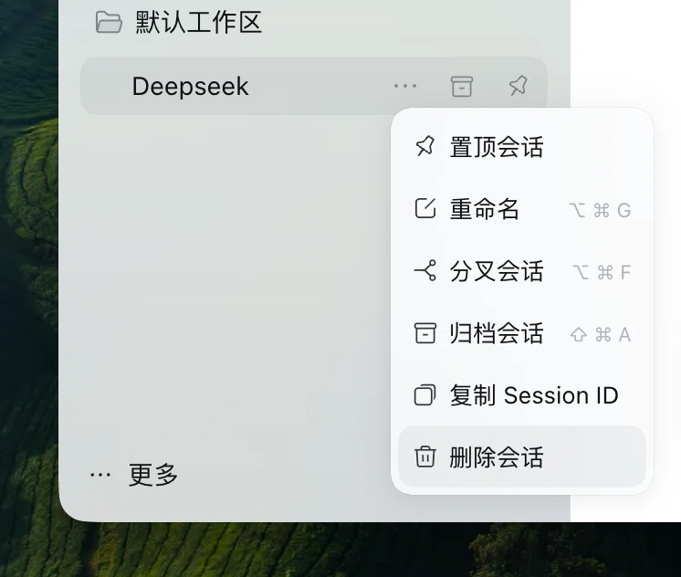

# dsh-x

A DeepSeek Harness plugin suite. One feature so far: delete a session.

## Install

**Client**: open **Plugins** → **Add plugin** and enter
`https://github.com/Linzzz14/dsh-x`.

**CLI, from the repository**:

```bash
dsh plugin --profile web add github:Linzzz14/dsh-x
```

**CLI, from a release package**:

```bash
dsh plugin --profile web add https://github.com/Linzzz14/dsh-x/releases/latest/download/dsh-x.tgz
```

If it does not take effect, restart the client.

## Delete a session

> ⚠️ Deletion is permanent, and it also removes the session's sub-sessions.

The last item of the session row "…" menu. It opens the same confirmation dialog as
the native *Delete workspace* action.



Deleting removes:

- the session itself and all of its records on disk
- every sub-session it created
- its entry in the workspace (membership, pin, archive)
- related caches and backups; a project folder that becomes empty is removed too

Attachments are kept — they are shared by several sessions, so deleting them from one
session could affect the others. Sessions that are still running cannot be deleted.

## License

[MIT](LICENSE)
