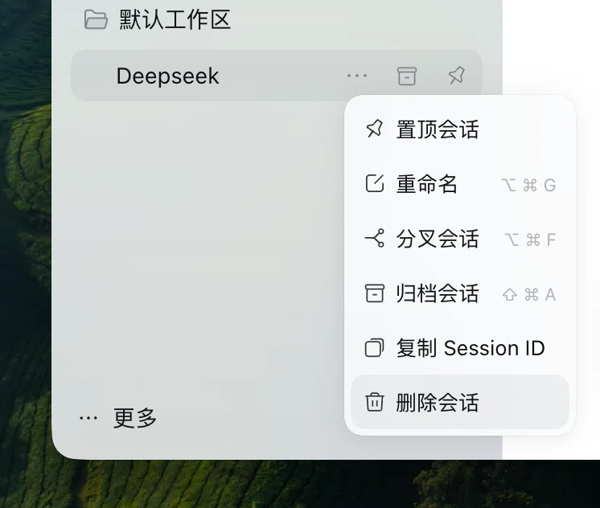

# dsh-x

DeepSeek Harness 插件套件。目前提供一项功能：删除会话。

## 安装

**客户端**：打开「插件」→「添加插件」，填入
`https://github.com/Linzzz14/dsh-x`。

**CLI，从仓库安装**：

```bash
dsh plugin --profile web add github:Linzzz14/dsh-x
```

**CLI，从发布包安装**：

```bash
dsh plugin --profile web add https://github.com/Linzzz14/dsh-x/releases/latest/download/dsh-x.tgz
```

如果装完没有生效，尝试重启客户端。

## 删除会话

> ⚠️ 删除不可恢复，并会连带删除该会话的子会话。

会话行「…」菜单的最后一项，点击后弹出与原生「删除工作区」相同的确认框。



删除会清理：

- 这个会话本身，以及它在磁盘上的全部记录
- 由它派生的所有子会话
- 它在工作区中的记录（所属、置顶、归档）
- 相关缓存和备份；项目文件夹变空时一并移除

附件不会删除——它们被多个会话共用，单独删除可能影响其他会话。正在运行的会话不能删。

## 许可

[MIT](LICENSE)
